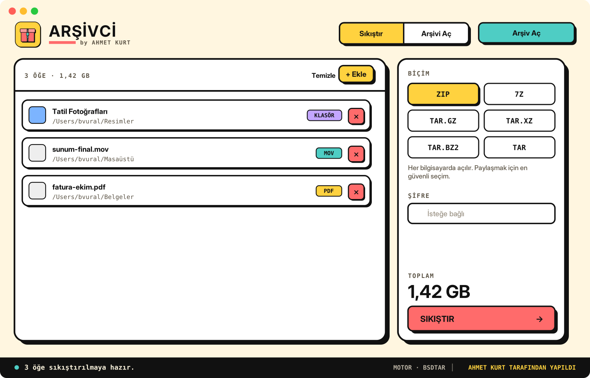
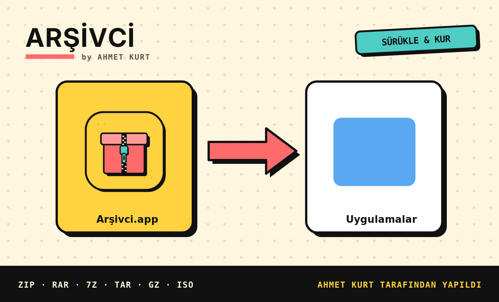

<p align="center">
  
</p>

<h1 align="center">Arşivci</h1>

<p align="center">
  <b>Mac için WinRAR benzeri arşiv uygulaması — her dosya türüyle çalışır.</b><br>
  Sıkıştır · Aç · Çıkar<br><br>
  <a href="../../releases/latest"><b>⬇️ Arsivci.dmg indir</b></a>
</p>

<p align="center"><i>Ahmet Kurt tarafından yapıldı.</i></p>

---



## Özellikler

- **Sıkıştır:** Her tür dosya ve klasör → ZIP, 7Z, TAR.GZ, TAR.XZ, TAR.BZ2, TAR. İsteğe bağlı şifre.
- **Aç ve çıkar:** ZIP, RAR (RAR5 dahil), 7Z, TAR, GZ, BZ2, XZ, ZST, ISO, CAB, CPIO, XAR, PKG, DEB, RPM, LHA, JAR, APK, IPA…
- **Seçerek çıkar:** Arşivin içeriğini listele, yalnızca istediğin dosyaları çıkar.
- **Arşivi test et:** Bozuk olup olmadığını kontrol eder.
- **Sürükle-bırak:** Pencereye, Dock simgesine ya da Finder'da *Birlikte Aç → Arşivci*.
- Açık ve koyu mod, Türkçe arayüz, ek kurulum gerektirmez (macOS'un yerleşik `bsdtar` motorunu kullanır).

## Kurulum

1. [Releases](../../releases/latest) sayfasından **Arsivci.dmg** dosyasını indir.
2. Çift tıkla ve açılan pencerede **Arşivci**'yi **Uygulamalar** kartına sürükle.



> **İlk açılışta uyarı çıkarsa:** Uygulama Apple tarafından onaylanmış (notarize) değil.
> *Sistem Ayarları → Gizlilik ve Güvenlik* bölümünün altında **"Yine de Aç"** düğmesine bas.
> Ya da Terminal'de: `xattr -cr /Applications/Arşivci.app`

**Gereksinim:** macOS 13 (Ventura) veya üstü · Apple Silicon ve Intel.

## İsteğe bağlı: 7-Zip ile daha fazlası

[Homebrew](https://brew.sh) ile 7-Zip kurulursa Arşivci onu otomatik kullanır: DMG/WIM gibi ek biçimler, AES-256 şifreli ZIP ve şifreli 7Z.

```bash
brew install sevenzip
```

## Kaynaktan derleme

```bash
git clone <bu-depo>
cd arsivci
bash kur.sh            # build/Arsivci.dmg oluşturur
```

Xcode Komut Satırı Araçları gerekir (`xcode-select --install`).

## Yeni sürüm yayınlama

`v` ile başlayan bir etiket gönderildiğinde GitHub Actions uygulamayı derler, DMG'yi oluşturur ve Releases'e yükler:

```bash
git tag v1.0.1
git push origin v1.0.1
```

## Notlar

- RAR **oluşturma** desteklenmez (RAR biçimi lisanslıdır); RAR açma tam desteklenir.
- 7-Zip kurulu değilken şifreli ZIP, macOS'un yerleşik `zip` aracıyla klasik ZipCrypto kullanır.

## Proje yapısı

```
Sources/     Swift kaynak kodu (Arsivci.swift: arşiv motoru, Arayuz.swift: arayüz)
Resources/   Info.plist, logo, DMG arka planı
scripts/     build-app.sh (derleme), dmg-settings.py (DMG penceresi)
.github/     Otomatik DMG + Release iş akışı
```

---

<p align="center">© 2026 Ahmet Kurt</p>
